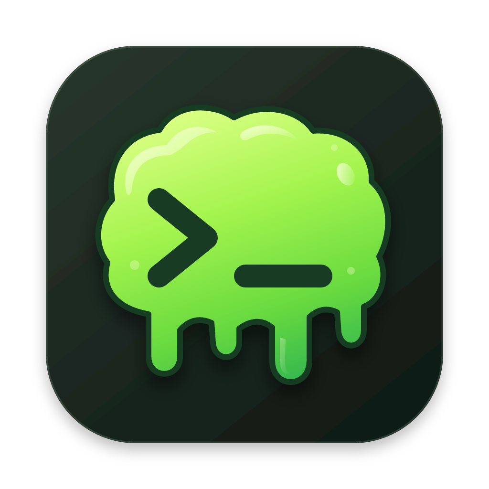

<p align="center">
  
</p>

<h1 align="center">slerm</h1>

<p align="center">A Ghostty-powered terminal with tiled and floating panes, written in Rust.</p>

slerm renders terminals with [libghostty-vt](https://github.com/ghostty-org/ghostty),
Ghostty's terminal engine, and draws them with [egui](https://github.com/emilk/egui)
on wgpu. It has its own built-in multiplexer, so you get tabs, tiled splits and
floating panes without tmux, plus a TypeScript plugin system for adding your own
panels.

## Features

- **Ghostty's terminal emulation**: the same VT parser and Kitty graphics protocol support.
- **Tabs, tiled panes and floating panes**, with zoom and keyboard focus movement.
- **Themes**: `slerm` plus every theme Helix ships (`slerm --list-themes`), with per-color overrides.
- **Font control**: pick a family or file, with bold/italic matching and fallback fonts for Nerd Font icons.
- **Plugins in TypeScript**, run in embedded [Boa](https://boajs.dev), with native sidebars and
  floating panels. Examples include a file tree, a git panel and a Hacker News reader.
  See the [plugin SDK docs](sdk/README.md).
- **Native macOS app**: a real `.app` bundle with Dock icon, menu bar and multiple windows.

## Install (macOS, Apple Silicon)

Download `slerm-<version>-macos-arm64.zip` from the
[Releases](../../releases) page, unzip it, and drag `slerm.app` into `/Applications`.

The app is ad-hoc signed, not notarized, so Gatekeeper blocks the first launch. Either
right-click the app and choose **Open**, or clear the quarantine flag:

```sh
xattr -dr com.apple.quarantine /Applications/slerm.app
```

## Build from source

With [Nix](https://nixos.org) (flakes enabled), which provides the Rust and Zig toolchains:

```sh
nix build            # result/Applications/slerm.app on macOS, result/bin/slerm elsewhere
nix run              # build and launch
nix develop          # dev shell with cargo, clippy, rustfmt, node and zig
```

Without Nix you need Rust 1.92+ and [Zig](https://ziglang.org) 0.15.2+, because the
build compiles Ghostty from source:

```sh
cargo build --release
scripts/bundle-macos.sh   # macOS only: wraps target/release/slerm in slerm.app
```

## Configuration

Create a commented config with every option, then edit it:

```sh
slerm --init-config     # writes ~/.config/slerm/config.toml (or $XDG_CONFIG_HOME/slerm/)
slerm --check-config    # validate it
```

Or read [`config.example.toml`](config.example.toml). Reload a running slerm with
`Ctrl+Shift+R`.

Default key bindings:

| Key | Action |
| --- | --- |
| `Alt+M` | New pane |
| `Alt+F` | Toggle floating panes |
| `Alt+H` `J` `K` `L` | Focus left, down, up, right |
| `Alt+A` | New tab |
| `Alt+Shift+H` / `Alt+Shift+L` | Previous / next tab |
| `Alt+X` | Close pane |
| `Alt+S` | Open scrollback in your editor |
| `Ctrl+Shift+Z` | Zoom pane |
| `Ctrl+Shift+C` / `Ctrl+Shift+V` | Copy / paste |
| `Ctrl+Shift+R` | Reload config |

Plugin commands can be bound too, for example `"Super+G" = "plugin:git/toggle-git"`.

## Plugins

Plugins are JavaScript bundles listed under `[[plugins]]` in the config and managed
from the **Plugins** menu. Write them in TypeScript against the generated SDK:

```sh
npm ci --prefix sdk
npm run example --prefix sdk   # builds sdk/dist/{panes,filetree,git,hackernews}.js
```

The full API is documented in [`sdk/README.md`](sdk/README.md). Plugins run with your
user's privileges, so only load ones you trust.

## Using the slerm theme in Helix

[`themes/slerm.toml`](themes/slerm.toml) is a Helix theme with slerm's colors, so an
editor running inside slerm blends in with it. See the header of that file for install
steps.

## Icon

The icon is [`assets/slerm.svg`](assets/slerm.svg). `nix run .#make-icon` regenerates
the PNG and ICNS; see [`assets/README.md`](assets/README.md).

## Releases

Every push to `main` runs
[`.github/workflows/release.yml`](.github/workflows/release.yml), which builds the
macOS app on GitHub Actions and uploads it as a build artifact. If no release exists
yet for the `version` in `Cargo.toml`, it also publishes `v<version>` on GitHub
Releases with the zip and its SHA-256 checksum. To cut a new release, bump the version
and push to `main`; no tag is needed, so it works with a Gitea-to-GitHub mirror.

## License

MIT. Bundled Helix themes keep their original licenses in
[`themes/LICENSES`](themes/LICENSES).
